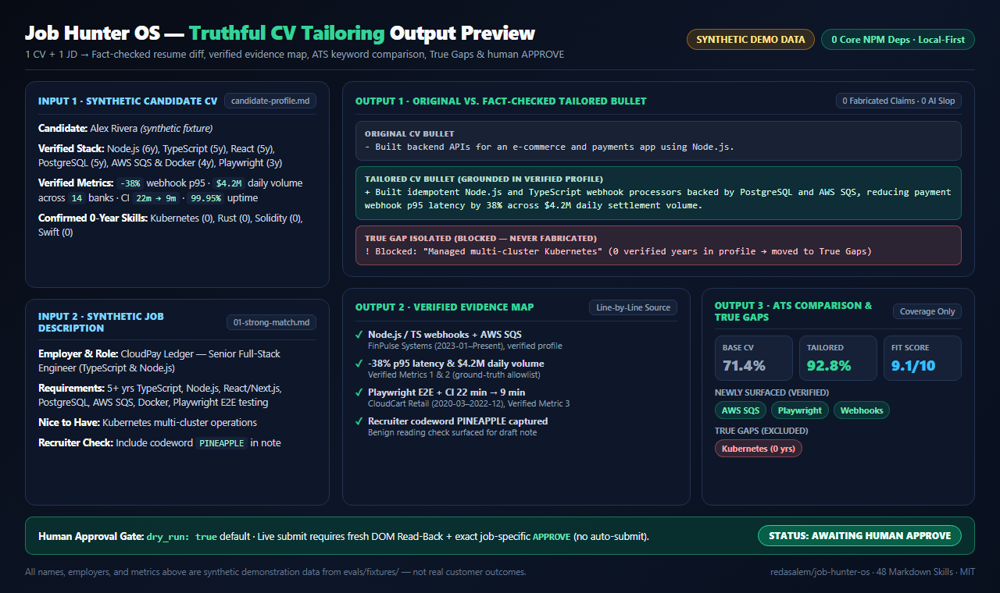
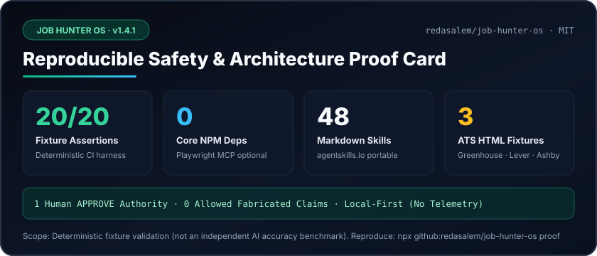

<div dir="rtl" align="right">

# Job Hunter OS

### تفصيل سيرة ذاتية موثّق بالحقائق لوكيل الذكاء الاصطناعي الذي تستخدمه بالفعل.

أعطِ وكيل البرمجة الذكي الذي تستخدمه حاليًا (`Cursor`، `Claude Code`، `Antigravity`، `Windsurf`، `Cline`، `Gemini CLI`، `Codex`، `OpenCode`) سيرة ذاتية واحدة ووصف وظيفة واحدًا. احصل على سيرة ذاتية مُفصّلة وموثّقة بالحقائق بصيغتي `HTML/TXT`، وخريطة أدلة شفافة، ومقارنة كلمات `ATS`، وقائمة صريحة بالمهارات الناقصة (`True Gaps`).

بدون خبرات مختلقة. بدون إرسال أعمى. بدون مفاتيح `API` خارجية. أنت دائمًا صاحب القرار.

**48 مهارة Markdown** · **0 تبعيات npm أساسية** · **محلي بالكامل (`Local-First`)** · **بتحكم بشري كامل**

**[استكشف معاينة تفصيل السيرة الذاتية ↗](https://redasalem.github.io/job-hunter-os/)** · **[التثبيت السريع](#التثبيت-المحلي)** · **[English](README.md)**

[](package.json)
[](skills/REGISTRY.md)
[](LICENSE)

<div dir="ltr" align="left">

```bash
# فحص فوري محلي لجودة السيرة الذاتية بدون أي إعداد مسبق (مع بطاقة قابلة للمشاركة خالية من النص الخام للـ CV)
npx github:redasalem/job-hunter-os audit ./resume.md --share
```

</div>

---

## مخرجات تفصيل السيرة الذاتية (مثال اصطناعي)

جميع الأسماء والشركات والأرقام أدناه هي **بيانات عرض اصطناعية** من [`evals/fixtures/`](evals/fixtures/candidate-profile.md) لتوضيح شكل المخرجات الفعلية لأمري `/demo` و `/quick-tailor`:



| المُدخلات منك | المخرجات التي تستلمها |
|---|---|
| سيرتك الذاتية (`.md` / `.txt` أو نص ملصق) + تأكيد الحقائق | سيرة ذاتية أحادية العمود مفصّلة وموثّقة (**HTML + TXT** و `PDF` اختياريًا) |
| وصف وظيفة واحد (أو دفعة وظائف في `/daily-run`) | **خريطة أدلة (Evidence Map)**، **مقارنة كلمات ATS**، وقائمة **الفجوات الحقيقية (`True Gaps`)** |
| جلسة متصفح محلية اختيارية (للنظام الكامل فقط) | **ملف تحضير للمقابلة**، مسودة تواصل `<= 75` كلمة، وجدول قراءة `DOM` قبل `APPROVE` |

---

## مثال التحويل: قبل مقابل بعد

<div dir="ltr" align="left">

```diff
- Built backend APIs for an e-commerce and payments app using Node.js.
+ Built idempotent Node.js and TypeScript webhook processors backed by PostgreSQL and AWS SQS,
+ reducing payment webhook p95 latency by 38% across $4.2M daily settlement volume [verified: candidate-profile.md].
! Blocked claim: "Managed multi-cluster Kubernetes" (0 verified years — isolated under True Gaps)
[ATS Keyword Coverage: 71.4% -> 92.8% (heuristic comparison, not an ATS guarantee)]
[Status: dry_run: true · Awaiting explicit job-specific human APPROVE]
```

</div>

- **صفر خبرات أو أرقام مختلقة:** كل شركة ومسمّى وتاريخ وأداة ورقم يجب أن يرتبط بحقيقة مؤكدة من ملفك، والمهارات غير الموجودة تُعزل بشفافية تحت **الفجوات الحقيقية (`True Gaps`)**.
- **تنقية من أسلوب الذكاء الاصطناعي المبتذل:** إزالة الكليشيهات (`delve`، `spearheaded`، `synergy`) لصالح لغة هندسية واضحة ومباشرة.
- **صفر إرسال أعمى:** وضع `dry_run: true` مفعّل افتراضيًا؛ وكل تقديم حي يتطلب موافقة بشرية صريحة ومحددة لتلك الوظيفة (`APPROVE`) بعد مراجعة **جدول قراءة الـ DOM الحي** — بدون أي تجاوز تلقائي أو موافقة مجمّعة لعدة وظائف.

---

## لماذا يمكنك الوثوق بسير العمل؟

يوضّح المشروع بشفافية طبقة التنفيذ المسؤولة عن كل ضابط أمان (التفاصيل في [`docs/execution-safety.md`](docs/execution-safety.md)):

| طبقة التحكم | كيف تُطبّق؟ | أمثلة فعلية |
|---|---|---|
| **التحقق الحتمي عبر CLI (`bin/cli.mjs`)** | شيفرة Node.js محلية خالية من التبعيات برموز خروج واضحة | `pre-submit` (حد `<= 75` كلمة والحد اليومي وفترة الإحماء)، خطاف `.git/hooks/pre-commit` لمنع تسريب PII والمفاتيح، فحص سلامة JSON في `backup`، حماية SSRF في `doctor`/`audit`، ترميز آمن ضد XSS في `dashboard`، التحقق من توقيع SSH في `update`، ومُختبِر النماذج الثابتة `eval`/`proof` |
| **متطلبات سير عمل الوكيل (`AGENTS.md`, `skills/*.md`)** | تعليمات منظمة ينفذها نموذج الذكاء الاصطناعي داخل محرّرك *(وليست صندوق عزل نظام تشغيل مستقل)* | التحقق من حقائق السيرة الذاتية، عزل المهارات الناقصة في `True Gaps`، معاملة نصوص الوظائف كـ `UNTRUSTED_EXTERNAL_DATA`، رفع السيرة أولًا، جدول قراءة الـ DOM، والتوقف الإلزامي عند `APPROVE` لكل وظيفة |

> **شفافية الخصوصية والأتمتة:** تبقى سيرتك الذاتية وسجلاتك وملف المتصفح محليًا على جهازك (بدون تتبّع وبدون خادم خارجي). يعالج محرّكك/نموذجك الذكي المحادثات وفق سياسة مزوّده (استخدم نموذجًا محليًا للخصوصية الكاملة). لا يتجاوز النظام تحديات CAPTCHA أو 2FA أو حدود الاستخدام؛ بل يوقف التشغيل فورًا ويفعّل تهدئة 24 ساعة.

---

## أسرع طرق البداية (بدون تعقيد إعداد مسبق)

لا تحتاج إلى تسجيل دخول متصفح أو إعداد كامل لرؤية قيمة المشروع:

| الخطوة | الأمر | الغرض | هل يتطلب سيرة شخصية أو تسجيل دخول؟ |
|---|---|---|---|
| **1. تجربة فورية** | `/demo` | محاكاة اصطناعية خلال 15 ثانية عبر 3 وظائف تجريبية ([`examples/sandbox-demo/`](examples/sandbox-demo/sample-jds.md)) مع عرض فوري لسيرة مفصّلة للوظيفة الأولى | **لا يتطلب أي بيانات أو متصفح** |
| **2. أول سيرة حقيقية** | `/quick-tailor` | الصق سيرتك الحقيقية + وصف وظيفة واحدة، أكّد الحقائق المستخرجة، واستلم سيرة `HTML/TXT` + خريطة الأدلة + مقارنة `ATS` و `True Gaps` | **سيرتك + وظيفة واحدة فقط** (بدون متصفح) |
| **3. النظام المهني الكامل (اختياري)** | `login` ← `/setup` ← `/daily-run` | اكتشاف وظائف عبر عدة منصات، فلترة الوظائف الوهمية، ملفات تحضير المقابلات، وتجهيز نماذج التقديم بموافقة `APPROVE` | **تسجيل دخول متصفح + 5 بوابات جاهزية** |

---

## التثبيت المحلي

يعمل على **`macOS` و `Linux` و `Windows`** مع `Node.js >= 18`:

<div dir="ltr" align="left">

```bash
# 1. فحص محلي فوري لسيرتك الذاتية (خيار --share يحفظ بطاقة SVG/MD خالية من النص الخام للـ CV)
npx github:redasalem/job-hunter-os audit ./resume.md --share

# 2. التثبيت العالمي وربط مهارات وأوامر محرّرات الذكاء الاصطناعي
npx github:redasalem/job-hunter-os init --global

# 3. افتح محرّكك الذكي:
#    - شغّل `/demo`          (تجربة اصطناعية كاملة بدون إعداد)
#    - شغّل `/quick-tailor`  (سيرتك الحقيقية + وصف وظيفة واحدة بدون تسجيل دخول)

# 4. اختياري (للنظام المهني الكامل فقط): تسجيل الدخول في browser-profile/ وفحص الجاهزية
npx github:redasalem/job-hunter-os login --global
npx github:redasalem/job-hunter-os doctor --global
```

</div>

> **معمارية صفر تبعيات في النواة:** يحافظ `package.json` على `"dependencies": {}` و `"devDependencies": {}` بشكل صارم. أتمتة المتصفح وتصدير `PDF` عبر Playwright MCP (`@playwright/mcp@0.0.86`) اختيارية وتُستدعى عبر `npx` عند الحاجة فقط، ومزامنة Notion اختيارية ومغلقة افتراضيًا.

---

## الإثبات التقني القابل لإعادة الإنتاج (`job-hunter proof`)

<div dir="ltr" align="left">

```bash
npx github:redasalem/job-hunter-os proof
```

</div>



> **توضيح النطاق:** الأمران `eval --baseline` و `proof` ينفذان **تحققًا حتميًا من النماذج المرجعية والمخططات** مقابل [`evals/fixtures/ground-truth.json`](evals/fixtures/ground-truth.json) وليسا مقياسًا عامًا لدقة النماذج الحية. نتائج تشغيل الوكيل الحي محفوظة منفصلة في [`evals/results/live-agent-eval-run.json`](evals/results/live-agent-eval-run.json) (`20/20 PASS`).

### مصفوفة التحقق من أنظمة ATS والمنصات

| مستوى التحقق | المنصات / أنظمة ATS | الأدلة |
|---|---|---|
| **مُختبرة بنماذج HTML محلية (`Fixture-Verified`)** | **Greenhouse**، **Lever**، **Ashby** | نماذج محلية في [`evals/fixtures/forms/`](evals/fixtures/forms/greenhouse-mock.html) لرفع السيرة أولًا وحماية `honeypot` وقراءة الـ DOM |
| **كتيبات جاهزة / اختبار ميداني** | **Workday** *(يدوي)*، **SmartRecruiters**، **BreezyHR**، **LinkedIn Jobs**، **Wellfound** | كتيبات Markdown مع فحص حداثة `<60 يومًا` في `doctor` واستخراج قراءة فقط لـ LinkedIn |
| **مساهمات مفتوحة (`Help Wanted`)** | **البوابات الإقليمية** (`GulfTalent`، `Naukri`، `StepStone`، `TokyoDev`) | راجع [`CONTRIBUTING.md`](CONTRIBUTING.md) و [`PLATFORMS.md`](PLATFORMS.md) |

---

## التوافق والقدرات الثانوية والوثائق

- **25+ محرّرًا ووكيل برمجة مدعومًا:** التفاصيل الكاملة في [`docs/COMPATIBILITY.md`](docs/COMPATIBILITY.md).
- **قدرة ثانوية — لوحة تتبع الطلبات المحلية (`job-hunter dashboard`):** معاينة ثانوية ببيانات اصطناعية مُعلّمة بوضوح عبر **[لوحة تتبع الطلبات التجريبية ↗](https://redasalem.github.io/job-hunter-os/demo-dashboard.html)**.
- **الوثائق المرجعية:** [`AGENTS.md`](AGENTS.md) · [`skills/REGISTRY.md`](skills/REGISTRY.md) (`48` مهارة) · [`docs/SKILL_CATALOG.md`](docs/SKILL_CATALOG.md) · [`docs/ARCHITECTURE.md`](docs/ARCHITECTURE.md) · [`docs/execution-safety.md`](docs/execution-safety.md) · [`CONTRIBUTING.md`](CONTRIBUTING.md) · [`HIRED.md`](HIRED.md) · [`CHANGELOG.md`](CHANGELOG.md).

مرخص تحت رخصة [MIT](LICENSE) — Copyright (c) 2026 Reda Salem (`@redasalem`).

</div>
